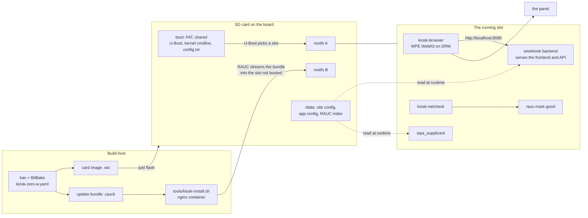

# meta-wisekiosk

A Raspberry Pi Zero W kiosk appliance: WPE WebKit straight to DRM, no desktop, no display server.
The unit shows one page and is reached only over WiFi, so everything here is shaped by the fact that
a broken image needs hands on the unit to recover.

The page is **WiseKiosk** ([`WisewareOrg/WiseKiosk`](https://github.com/WisewareOrg/WiseKiosk)),
built from source into the image at one pinned commit and served by the board itself, so the panel
depends on no remote origin. Updates are RAUC A/B over U-Boot, delivered over the LAN. Site
configuration is never in the image: provisioning writes it to the board's `/data` partition, which
both slots share.

Every document in the repository is listed in [Documentation](#documentation) below.

> ## Attribution
>
> This project builds on [jsmith212/meta-autonomos](https://github.com/jsmith212/meta-autonomos),
> which supplies the `autonomos` distro, the RAUC bundle recipe and the Raspberry Pi platform layer.
> kas fetches it at a pinned commit into `sources/`; this repository contains none of it.
>
> The upstream repository carries **no top-level license**. Its core layer contains a `COPYING.MIT`
> (standard Yocto layer boilerplate) and its README defers to per-recipe licenses, so the licensing
> of the tree as a whole is unclear — all rights not clearly granted remain with its author. Nothing
> here is offered under any license on their behalf, and nothing here redistributes it — `sources/`
> is gitignored and every user fetches upstream directly from upstream.
>
> Upstream's identifiers — the `autonomos` distro, `AUTONOMOS_FEATURES`, the `meta-autonomos-*` layer
> names — are left as upstream spells them: the RAUC compatible string derives from them
> ([`docs/updates.md`](docs/updates.md) §"The one-way lock"), and the patch in
> `patches/meta-autonomos/` has to apply to upstream's files as upstream writes them.

## Mission

Give the WiseKiosk application a dedicated home on one board: one that shows it well, and that its
operator can set up and leave.

The appliance is a vessel. What the viewer sees is the application, and everything here exists
to serve that.

- **The application, shown well.** The WiseKiosk instance is on the panel, live, and running smoothly.
- **Self-sufficient.** Everything the instance needs runs on the one board. A deployment depends on
  no other machine the operator runs.
- **Isolated.** Each appliance is its own deployment, unrelated to and unconnected with every other.
- **Easy to keep.** The operator configures, deploys and maintains it, primarily without a visit to the panel.

## Architecture



The image is built on a host from pinned upstream layers plus this repository's one layer,
`meta-wisekiosk/`. A card is flashed once; afterwards each update is a signed RAUC bundle the board
streams into the slot it is not running, and U-Boot boots that slot next. Everything site-specific
lives on `/data`, which both slots share. On the running slot, `kiosk-browser` shows the WiseKiosk
page that the board's own backend serves, and the slot is marked good only once the board has
reached its network.

## Documentation

This is the only index of the repository's documents.

| Document | What it answers |
|---|---|
| [`CONTRIBUTING.md`](CONTRIBUTING.md) | How to change the repository: the checks, the conventions, and how a change merges |
| [`CLAUDE.md`](CLAUDE.md) | The rules an AI agent works under here |
| [`docs/image.md`](docs/image.md) | How the image is built: kas, layers and pins, the build host, the build stamp and the reproducibility gate |
| [`docs/display.md`](docs/display.md) | How the page reaches the panel: WPE WebKit on DRM, the launcher, the consoles |
| [`docs/updates.md`](docs/updates.md) | How a board is updated and falls back: RAUC A/B, bundles, the shared `/boot`, the signing key and its rotation |
| [`docs/device.md`](docs/device.md) | The board: provisioning and `/data`, boot, network, time, logs, memory, getting in |
| [`docs/security.md`](docs/security.md) | What the image is made of, which packages carry published vulnerabilities, and how far the pins have fallen behind |
| [`docs/testing.md`](docs/testing.md) | What each testing tier proves, how the bench runner runs it, and how a test is written |
| [`docs/requirements/README.md`](docs/requirements/README.md) | What the appliance owes its viewer and operator, and which check verifies each |
| [`docs/decisions/README.md`](docs/decisions/README.md) | Which choices took a trade study, what was rejected, and why |
| [`tests/replay/README.md`](tests/replay/README.md) | What a replay set holds, and how one is re-recorded |
| [`.claude/skills/measure-first/SKILL.md`](.claude/skills/measure-first/SKILL.md) | How a question about the board is measured and tested |

Each module of the layer has a README: what it puts on the image, how it fits, and its knobs.

| Module | What it is |
|---|---|
| [`classes`](meta-wisekiosk/classes/README.md) | The build stamp's cache-safety class and the static `/etc/resolv.conf` |
| [`recipes-bsp/bootfiles`](meta-wisekiosk/recipes-bsp/bootfiles/README.md) | Firmware HDMI settings in `config.txt` |
| [`recipes-bsp/u-boot`](meta-wisekiosk/recipes-bsp/u-boot/README.md) | U-Boot with no boot delay |
| [`recipes-connectivity/openssh`](meta-wisekiosk/recipes-connectivity/openssh/README.md) | One ssh host key instead of three |
| [`recipes-connectivity/wpa-supplicant`](meta-wisekiosk/recipes-connectivity/wpa-supplicant/README.md) | The WiFi unit, reading its credentials from `/data` |
| [`recipes-core/bundles`](meta-wisekiosk/recipes-core/bundles/README.md) | The adaptive update bundle and its post-install hook |
| [`recipes-core/images`](meta-wisekiosk/recipes-core/images/README.md) | The rootfs image, sized to its content |
| [`recipes-core/kiosk-bootprof`](meta-wisekiosk/recipes-core/kiosk-bootprof/README.md) | The boot profiler, and how a profile is taken and read |
| [`recipes-core/kiosk-cpufreq`](meta-wisekiosk/recipes-core/kiosk-cpufreq/README.md) | The CPU frequency cap |
| [`recipes-core/kiosk-drmgrab`](meta-wisekiosk/recipes-core/kiosk-drmgrab/README.md) | The screen reader behind screenshots |
| [`recipes-core/kiosk-hardware`](meta-wisekiosk/recipes-core/kiosk-hardware/README.md) | Boot trims, the watchdog, panic and out-of-memory settings |
| [`recipes-core/kiosk-journal`](meta-wisekiosk/recipes-core/kiosk-journal/README.md) | The persistent journal on `/data` |
| [`recipes-core/kiosk-netcheck`](meta-wisekiosk/recipes-core/kiosk-netcheck/README.md) | The network check that gates marking a slot good |
| [`recipes-core/kiosk-provision`](meta-wisekiosk/recipes-core/kiosk-provision/README.md) | Applying the site configuration at boot |
| [`recipes-core/kiosk-recover`](meta-wisekiosk/recipes-core/kiosk-recover/README.md) | The script that reverses the boot trims for debugging |
| [`recipes-core/kiosk-session`](meta-wisekiosk/recipes-core/kiosk-session/README.md) | The browser launcher and its unit |
| [`recipes-core/kiosk-soak`](meta-wisekiosk/recipes-core/kiosk-soak/README.md) | The memory and load sampler, and how to read it |
| [`recipes-core/kiosk-timesync-persist`](meta-wisekiosk/recipes-core/kiosk-timesync-persist/README.md) | The saved clock on `/data` |
| [`recipes-core/rauc`](meta-wisekiosk/recipes-core/rauc/README.md) | RAUC's slot table, compatible and keyring path |
| [`recipes-core/udev`](meta-wisekiosk/recipes-core/udev/README.md) | The add-on-hardware udev rules removed |
| [`recipes-devtools/nodejs`](meta-wisekiosk/recipes-devtools/nodejs/README.md) | The Node.js the app's frontend builds with |
| [`recipes-extended/zram`](meta-wisekiosk/recipes-extended/zram/README.md) | Compressed swap in RAM |
| [`recipes-kernel/linux`](meta-wisekiosk/recipes-kernel/linux/README.md) | The kernel's patches and configuration |
| [`recipes-support/icu`](meta-wisekiosk/recipes-support/icu/README.md) | The trimmed ICU locale data |
| [`recipes-wisekiosk/wisekiosk`](meta-wisekiosk/recipes-wisekiosk/wisekiosk/README.md) | The WiseKiosk application, built from source |

## Layout: scaffolding vs. layer

The repository is a project, not a layer. Exactly one directory in it is a BitBake layer.

```
meta-wisekiosk/                    <- the repository (project scaffolding)
├── README.md, CONTRIBUTING.md     what this is; how to change it and get it merged
├── CLAUDE.md                      working rules for an AI agent
├── .claude/                       session settings, hooks and skills for an AI agent
├── kiosk-zero-w.yaml              kas config: the one entry point
├── includes/                      repo pins and machine config, pulled in by the above
│   ├── base.yaml                  every repo + commit, incl. meta-autonomos and its patches
│   ├── rauc.yaml
│   ├── cve-audit.yaml             opt-in cve-check overlay, joined on by `just cve-build`
│   └── platforms/
│       ├── raspberrypi.yaml
│       └── raspberrypi-zero-w.yaml
├── patches/<repo>/                patches kas applies to upstream checkouts
├── meta-wisekiosk/                <- THE LAYER: recipes, bbappends, classes
│   ├── conf/layer.conf
│   ├── classes/
│   └── recipes-*/
├── Justfile, justfiles/           build, OTA and device commands
├── tools/                         provisioning, bundle delivery, device debugging, doc gate,
│                                  the identity scan, the build-commit writer and
│                                  reproducibility gate
├── docs/                          subsystem documents, decisions/, requirements/
├── tests/                         the bench runner's suites; tests/prechecks/ needs no board and is
│                                  what CI runs besides the doc and identity tools
└── sources/                       gitignored; everything kas fetches lands here
```

New to Yocto: [`docs/image.md`](docs/image.md) explains what a layer is and what kas does with
these files.

## Quick start

Set up the build host once — Docker, `kas-container`, the repository's Python tools and the shared
hash-equivalence server — as [`docs/image.md`](docs/image.md) §"Setting up a build host" says, and
put the site's values in `~/.config/wisekiosk/secrets.yaml`, copied from
[`secrets.yaml.tmpl`](secrets.yaml.tmpl) and kept outside this public repository. Then:

```sh
just build                          # the image (docs/image.md)
just flash /dev/sdX                 # a new card (docs/device.md)
just provision-fresh-card /dev/sdX  # its site configuration, before first boot
export KIOSK_HOST=root@<addr>       # the board the next recipes reach (docs/device.md)
just kiosk-ota                      # an update to a running board (docs/updates.md)
just kiosk-reboot
```

`just` alone lists every recipe beside what it does.
