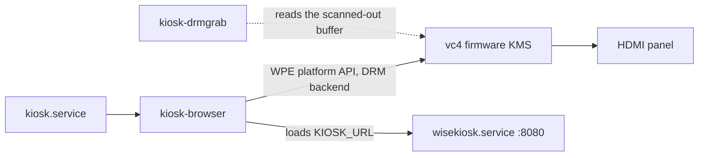

# The display

The kiosk shows one page, full screen, taking no input. WPE WebKit draws it straight to the kernel's
DRM display; there is no display server, compositor or toolkit. Why this stack and not another is
[ADR 0001 rev 2](decisions/0001-wpe-webkit-on-drm-with-our-own-launcher.md).

## The engine

WPE WebKit comes from the `meta-webkit` layer, pinned by commit in `includes/base.yaml`, and is the
largest thing the image builds ([`image.md`](image.md) §"What a rebuild costs"). `kiosk-zero-w.yaml`
builds it with only what the page uses: its own DRM platform, `gbm`, `journald` logging, the remote
inspector, `woff2` for the app's bundled fonts, and `reduce-size`; GStreamer and WebGL are off.
On the board's ARMv6 core WebKit has no JIT. The image therefore plays no audio or video and draws
no WebGL, and a site whose page needs one of those is out of scope.

Text renders in Roboto; the DejaVu families the engine recommends are kept out. Locale data is cut to
what text rendering needs ([`recipes-support/icu`](../meta-wisekiosk/recipes-support/icu/README.md)).

## The launcher

`kiosk-browser` is one C file of this layer's own
([`recipes-core/kiosk-session`](../meta-wisekiosk/recipes-core/kiosk-session/README.md)). It opens
the page full screen on WPE's platform API and owns what a stock browser would not: it retries a
failed load in place, tells systemd's watchdog the page is alive each time the page answers a
script, and exits when another console is brought forward. WebKit's paint-damage propagation is off,
so every frame repaints whole.

`kiosk.service` runs it after the network is online and `/data` is mounted, restarts it whatever its
exit, and stops it when its watchdog goes unanswered (`WatchdogSec`, among the module's knobs), so a
page that hangs is restarted like one that crashed. The page is `KIOSK_URL`, by default the local app on
`http://localhost:8080`, which `wisekiosk.service` serves from the board itself, so the panel depends
on no remote origin. A site that sets `KIOSK_URL` in `/data/config/kiosk.conf` points the browser
elsewhere; the same file turns the remote inspector on.

## The panel

The panel is driven through firmware KMS: `VC4DTBO = "vc4-fkms-v3d"` in
[`kiosk-zero-w.yaml`](../kiosk-zero-w.yaml) puts `dtoverlay=vc4-fkms-v3d` in `config.txt`, and mesa
provides EGL on top of it. mesa is held at poky's version, because meta-raspberrypi's newer recipe
needs a Rust toolchain for ARMv6 that nothing else here needs, so `just preferred-version` reports it
behind by design. The mode is the kernel's: `video=` in the kernel's `panel-mode.cfg`
([`recipes-kernel/linux`](../meta-wisekiosk/recipes-kernel/linux/README.md)), which travels in an
update with the kernel. The firmware HDMI settings
([`recipes-bsp/bootfiles`](../meta-wisekiosk/recipes-bsp/bootfiles/README.md)) bring the output up
when the panel is slow to answer at boot.

### Firmware KMS

Full KMS (`vc4-kms-v3d`) gives this panel a black picture on a live signal, at every mode and
compositing setting tried, so it is not an option on this display. The value is set outright rather
than taken as a default, because meta-raspberrypi spells `VC4DTBO` as a weak `?=` that several of
its machine configurations override. Like every `config.txt` line, the overlay reaches a board only
when its card is flashed: [`updates.md`](updates.md) §"The shared /boot".

## Consoles

The panel is the system console: the kernel writes to `tty1` only, so a panic early in boot is read
off the panel, and there is no serial console. The page owns `tty1` and shows no login prompt. A USB
keyboard reaches a login on `tty2` (`getty@tty2`, [`recipes-core/kiosk-hardware`](../meta-wisekiosk/recipes-core/kiosk-hardware/README.md)),
which is the way in when the network is gone; switching to it stops the browser, and `chvt 1` brings
the page back. The image keeps the kernel's keyboard and USB host support for that reason.

Screen blanking is off. TST007<!-- Display blanking disabled --> checks it by the kernel's own report
of the panel's power and the console's blanking timeout; a panel that powers itself down is not
covered.

## Seeing the panel from the workstation

The correct picture of a healthy kiosk is often a page nobody is watching, and the board has no
display server to ask. [`kiosk-drmgrab`](../meta-wisekiosk/recipes-core/kiosk-drmgrab/README.md) on
the board reads the buffer the panel is scanning out, and
[`tools/kiosk-screenshot.py`](../tools/kiosk-screenshot.py) (`just screenshot`) runs it over ssh and
writes an image on the workstation. The engine's remote inspector, when switched on, answers on the
board's loopback, and [`tests/board/app/inspector.py`](../tests/board/app/inspector.py) reaches it
through a forwarded port.
