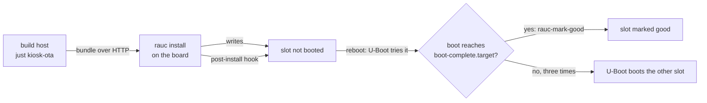

# Updates

The board is updated over the LAN and never needs its card pulled for one. Its card holds two
complete root filesystems, slot A and slot B; it runs one, an update is written into the other, and
U-Boot boots the new slot next. If the new slot does not come up, the board falls back to the old
one by itself. Everything site-specific lives on `/data`, which both slots share, so an update
replaces the software and keeps the site.



## The card

| Partition | Holds | Written by |
|---|---|---|
| 1, FAT, `/boot` | U-Boot, its environment, `config.txt`, `cmdline.txt` | the card flash only |
| 2, slot A | a complete rootfs | the card flash, then updates |
| 3, slot B | a complete rootfs, empty until the first update | updates |
| 4, `/data` | site configuration, the app's configuration, RAUC's status and indexes, the journal, the saved clock | the card flash (empty), then provisioning and the running system |

RAUC's slot table, compatible string and keyring path are in
[`recipes-core/rauc`](../meta-wisekiosk/recipes-core/rauc/README.md); the rootfs is sized to its
content and grown to its slot after each write
([`recipes-core/images`](../meta-wisekiosk/recipes-core/images/README.md)).

## Falling back

U-Boot keeps a boot order and an attempt count per slot in its environment. A slot that fails to
boot three times leaves the order, and the other slot boots. A slot counts as booted only when
`rauc-mark-good.service` marks it good, which waits on `boot-complete.target`, and
[`kiosk-netcheck`](../meta-wisekiosk/recipes-core/kiosk-netcheck/README.md) holds that target back
until the board has reached its LAN. A slot that boots but cannot reach the network is therefore
treated like one that does not boot — the failure an A/B scheme does not otherwise see on a board
reached only over WiFi. `kiosk-netcheck` never marks a slot bad itself, and lets a slot be marked
good when no good fallback is known.

`just kiosk-rollback` marks the booted slot bad by hand, and the next reboot takes the other one. A
rollback undoes a bad rootfs only: `/data` is the same on both slots, so a fault in the site
configuration survives it, and is fixed by provisioning again
([`device.md`](device.md) §"Provisioning").

## Delivering an update

```sh
just kiosk-ota      # build the bundle, preflight, install into the slot not booted
just kiosk-reboot   # reboot into it and wait for the kiosk to answer
just kiosk-rollback # if the new slot comes up wrong
```

`just build` builds the image only; `just kiosk-bundle`, which `kiosk-ota` runs first, builds the
signed RAUC bundle around it. `kiosk-preflight` then refuses a delivery that cannot work — a bundle
whose image does not fit the slot, a stale bundle, a tree the reproducibility gate refuses
([`image.md`](image.md) §"The reproducibility gate"). Every install, by hand, by the key rotation or
by a test, goes through [`tools/kiosk-install.sh`](../tools/kiosk-install.sh), whose header says
what it does and what it records while the slot is written.

The board streams the bundle over HTTP from a short-lived server on the installing host, and the
bundle is adaptive (`block-hash-index`): RAUC hashes both slots and fetches and writes only the
blocks neither already holds, keeping each slot's index in `/data/rauc`. RAUC documents adaptive
updates as an optimisation for HTTP streaming, and streaming is what lets it fetch by range instead
of copying the whole bundle first. The rootfs image is sized to its content rather than to its slot,
and `resize=true` in RAUC's `system.conf` grows the slot's filesystem to its partition after each
write, so an install moves and writes the image's content, not an empty filesystem the size of the
slot. The image builds no casync bundle.

What follows from that design:

- A slot's first adaptive install hashes the slot to build its index, so it is the slowest.
- `resize=true` is read from the running system's `system.conf`, so an install made from an image
  without it leaves that slot at its content size until the slot is next written.
- The installing host needs Docker, a port the board can reach at the address the host's ssh
  session comes from, and memory for one copy of the bundle; NAT or an ssh jump between the two
  breaks the install.
- One host installs on one board at a time: a second install's set-up would clear the first's crash
  records, so `tools/kiosk-install.sh` refuses it and names the holder.

Every recipe that talks to a board takes its default from the `kiosk-host` variable in the
[`Justfile`](../Justfile), so `export KIOSK_HOST=root@<addr>` points all of them at one board, and
an explicit `host` argument wins over it. There is no default in the tree, because an address is
site-specific; `just find <cidr>` learns a board's address on the LAN.

## What a new slot carries

Each slot carries its own copy of the device's machine-id, which journald reads before `/data` is
mounted. The bundle's post-install hook copies it from `/data` into the slot it has just written
([`recipes-core/bundles`](../meta-wisekiosk/recipes-core/bundles/README.md)), so a board keeps one
identity, and one journal, across updates.

A slot boots with the clock its image carried until `systemd-timesyncd` restores the saved one from
`/data` ([`recipes-core/kiosk-timesync-persist`](../meta-wisekiosk/recipes-core/kiosk-timesync-persist/README.md)).
That matters here because RAUC checks a bundle's signing certificate against the board's clock, and
refuses one that is not yet valid.

### The first boot of a written slot

The first boot of a slot an update has just written does work no later boot repeats: the units
gated on `ConditionNeedsUpdate=` (`ldconfig`, the journal catalog update, the machine-id commit)
and OpenSSH's host-key generation. Until the host keys exist `sshd` accepts no session, so for tens
of seconds the board answers `ping` and refuses `ssh`; that is not a failed update. The same work
slows everything else on that boot, so a steady-state figure is read from the second boot.

## The shared /boot

The card's first partition, FAT and mounted at `/boot`, holds U-Boot, its environment
(`uboot.env`), `config.txt` and `cmdline.txt`, and both slots share it. RAUC writes only the
rootfs slots (`RAUC_BUNDLE_SLOTS = "rootfs"`), so nothing on `/boot` travels in an update: a
`config.txt` key, the kernel command line, a device-tree overlay and U-Boot's settings reach a board
only when its card is flashed. The kernel and its modules load from the rootfs slot, so they do
travel in an update and fall back with their slot.

A bad write to `/boot` breaks both slots at once, and the card has to be pulled. A change that can
live in the rootfs, as a unit or a sysctl, lives there, so an update carries it and a failed slot
falls back. Where a `/boot` file has to change on a running board by hand, the partition is backed
up first, each file is written atomically (temporary file, `fsync`, rename), and a restore puts back
the one file — never the whole partition, which overwrites `uboot.env` and with it both slots' boot
state.

## The one-way lock

A board accepts a bundle only when it is signed by a key in the keyring of the slot it is running,
and only when the bundle's compatible string equals its own. Neither can be undone remotely: a board
given a keyring or a compatible that no bundle matches takes no further update, and is recovered
only by flashing its card.

The compatible string is `autonomos-${MACHINE}`, a literal set by meta-autonomos's
`autonomos-rauc.bbclass`. That is why the upstream identifiers — the `autonomos` distro, the
`meta-autonomos-*` layer names — are left as upstream spells them: moving off that class or
renaming them changes the compatible and strands every board in the field.

## The signing key

`update-bundle.bb` signs the bundle and meta-autonomos-core's `rauc-conf.bbappend` bakes the
keyring, and both read the same `AUTONOMOS_RAUC_*` variables, set in `kiosk-zero-w.yaml`, so the
signer and the trusted keyring cannot drift apart. They name the project's key in
`local/keys/kiosk-2026/`: gitignored, so it is never committed and no clone contains it.
`kas-container` mounts the repository root, which is how the build reads it.

Not committing the key is the whole protection, and the cost is that git cannot give it back:
`git clean -xfd` deletes it and no checkout restores it, so it is backed up outside the tree. Losing
every copy ends updates for every board, leaving a card flash as the only way back.

A clone without the key cannot build: recipe parsing stops on the missing `signing.cert.pem` rather
than falling back to another key and producing an image the boards reject. Before a first build the
key is restored from the backup, or, for a new fleet, made with `just rotate-keygen kiosk-2026`.
A fresh key buys no access to boards that trust another; that takes a rotation, below. The bench
host's checkout holds no key of its own: its environment file names `PIPELINE_KEYS_DIR`, which
[`tools/kas-run.sh`](../tools/kas-run.sh) mounts read-only over `local/keys`.

`just flash` checks the keyring baked into the image against this key and refuses a card that
differs, or one whose image and rootfs come from different builds: a card written with the wrong
keyring is repaired only by another flash.

The development key upstream ships, `development.key.pem`, is public, and no board here trusts it.
`.gitleaks.toml` allowlists the path a copy of it once had in this repository's history, which is
where `gitleaks detect` looks; the entry goes only if that history is rewritten.

## Rotating the signing key

A board checks a bundle against the keyring of the slot it is running, not the one the bundle
carries, so a board on the old key refuses a bundle signed with the new one outright. Rotation
therefore moves the keyring in two bundles, in a fixed order:

- the **transition** bundle carries the new keyring and is signed with the old key, so a board on
  the old key accepts it; booting it makes that slot trust the new key;
- the **end-state** bundle carries the new keyring and is signed with the new key; installed from
  the slot that trusts the new key, it brings the other slot onto it.

Each phase installs to the slot not booted and reboots into it, like any update, and the other slot
keeps trusting a key it can verify, so a failed phase falls back. `tools/rauc-rotate.sh` checks after
each reboot that the board switched slots and that the booted keyring is the new certificate, and
stops with recovery guidance if either fails.

1. **Make the new key** — `just rotate-keygen <name>`, named for its year (`kiosk-2027`; the
   certificate's CN drops the prefix). The name is given explicitly: `rotate-keygen` will not
   overwrite an existing pair, and `rotate-build` will not rotate a key to itself.
2. **Build the two bundles** — `just rotate-build <name>` writes `transition.raucb` and
   `new-signed.raucb` under the gitignored `build/rotation/`, and checks with `debugfs` that the
   keyring baked into the rootfs is the new certificate. Each install passes the reproducibility
   gate, so the tree is committed and pushed before this step, which takes two full builds.
3. **Give the host ssh key access** — `just rotate-provision-ssh root@<host>`, once per board that
   lacks it.
4. **Rotate the bench board and prove it** — `just rotate-run root@<bench> <name>`, then
   `just rotate-verify root@<bench> <name> --empirical build/rotation/transition.raucb build/rotation/new-signed.raucb`,
   which shows an old-signed bundle refused and a new-signed one accepted.
5. **Rotate every other board** the same way, by `just rotate-run`. Flashing a card with the new
   keyring is the fallback, never a step ahead of the bench proof.

`just rotate-verify` without `--empirical` compares the board's keyring fingerprint with the new
certificate; because the keyring is one self-signed certificate, a match already means old-signed
bundles are refused. `--empirical` proves it through `rauc info` on the board, at the cost of two
bundle transfers.

Once every board is rotated and verified, two sites that name the key by hand change together —
earlier, and the build signs with a key the boards do not trust:

| Site | What to change |
|---|---|
| `Justfile` — `fleet-key` | The key name: the `flash` keyring check and the rotation recipes' old-key default. |
| `kiosk-zero-w.yaml` — `AUTONOMOS_RAUC_KEY_DIR` | The same name; BitBake cannot read a `just` variable. |

`build/rotation/keydir` is scratch: `tools/rauc-rotate-build.sh` copies both keys there, mode `700`
and `600`, so the rotation build can sign with the old key while baking the new keyring. The
tools are `tools/rauc-keygen.sh`, `tools/rauc-rotate-build.sh`, `tools/rauc-rotate.sh`,
`tools/rauc-rotate-verify.sh` and `tools/rauc-provision-ssh.sh`, wrapped by
[`justfiles/rotate.just`](../justfiles/rotate.just).
